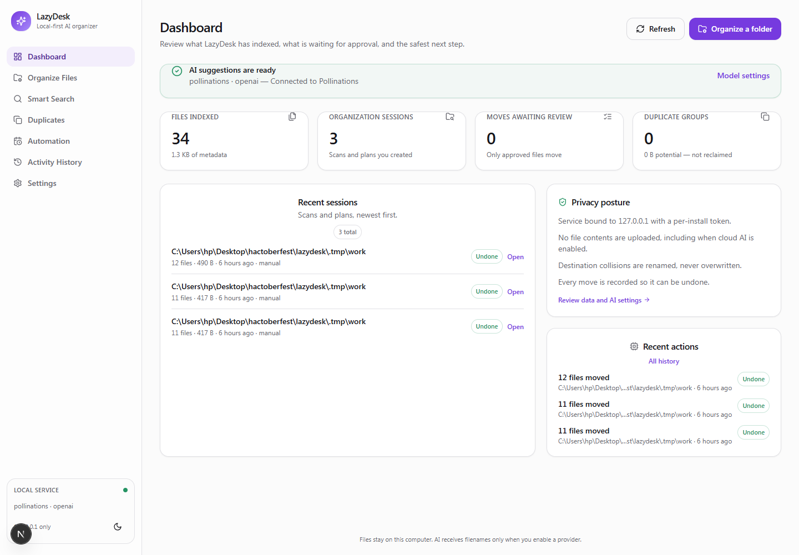
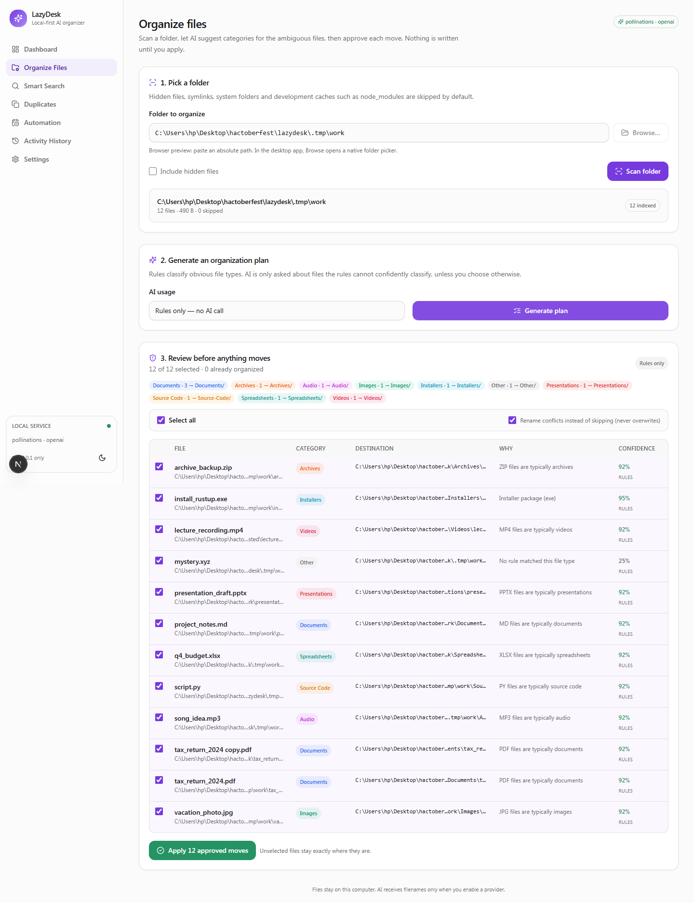
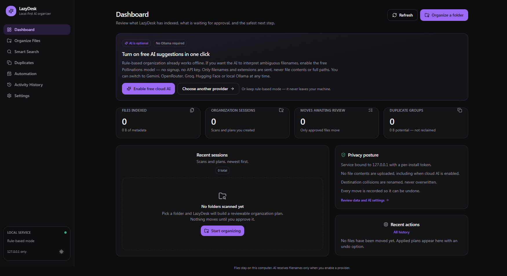

# LazyDesk

**Stop sorting files. Let LazyDesk do the boring work.**

LazyDesk is a local-first desktop app that scans a messy folder, proposes a category-based structure, and moves **only the files you approve**. It uses open-weight AI models for the ambiguous cases, deterministic rules for everything obvious, and records every move so it can be undone.

Built for the **Hacktoberfest Open-Source AI Challenge — Week 3: Slow and Steady**.



_Shown in the browser preview; the same UI runs inside the Electron shell._

## Why it is different

| | Typical AI file tool | LazyDesk |
|---|---|---|
| Where files go | Uploaded to a cloud service | Stay on your disk |
| AI requirement | Paid API required | Free hosted model **or** local Ollama **or** no AI at all |
| File moves | Automatic and opaque | Previewed, per-file approval, undoable |
| Overwrites | Often possible | Never — conflicts are renamed or skipped |
| Cost | Subscription | $0 by default |

The AI is used for what it is good at — interpreting names like `tax_return_2024.pdf` or `mystery.xyz` — while the safe, boring parts remain deterministic code.

## Features

- **Smart folder scanner** — metadata only; skips hidden files, symlinks, OS folders and development caches.
- **AI categorization with a rules fallback** — 11 categories, custom folder names, structured JSON validated with Pydantic.
- **Reviewable plans** — original path, destination, reason, confidence, conflict warnings, per-file selection.
- **Safe apply and undo** — no overwrites, collision-safe renaming, operation history, path re-validation before undo.
- **Exact duplicate detection** — SHA-256 after a size pre-filter; nothing is ever deleted automatically.
- **Natural-language search** — metadata filters always work; optional embeddings rerank results.
- **Opt-in automation** — saved rules with review-first mode, or explicit per-rule auto-apply.
- **Privacy controls** — cloud consent, filename-only prompts, content-indexing consent, local service token.



## Quick start (development)

### Prerequisites

- **Node.js 20+** and npm
- **Python 3.12+**
- Git

Python is only needed to run the local service. Ollama is **optional** — LazyDesk works with free hosted models or with rules alone.

### Install

```bash
git clone https://github.com/<your-username>/lazydesk.git
cd lazydesk
npm install

cd services/organizer
python -m venv .venv
# Windows
.venv/Scripts/python.exe -m pip install -r requirements.txt
# macOS / Linux
.venv/bin/python -m pip install -r requirements.txt
cd ../..
```

### Run in the browser

```bash
npm run dev
# open http://localhost:3000
```

### Run in the Electron desktop shell

```bash
npm run dev:desktop
```

For the packaged/static path without the Next dev server, build the UI and launch Electron directly:

```bash
npm run build:web
npm run start:desktop
```



Both commands start the Python service on `127.0.0.1:8765` and Next.js on port 3000 with a shared per-session token. The browser mode is for development; the desktop shell injects the token through a sandboxed preload bridge instead of a public environment variable.

### Try it safely

Copy the fictional demo folder first — LazyDesk never modifies files until you approve a plan, but practicing on a copy is still a good habit:

```bash
cp -r demo/MessyDownloads ~/Desktop/LazyDeskDemo
# then paste ~/Desktop/LazyDeskDemo into the Organize page
```

The demo files contain no real personal data.

## Free AI setup (no Ollama required)

Open **Settings → AI provider**. Cloud providers require one explicit consent toggle: LazyDesk then sends **file names, extensions and sizes only** — never file contents or full folder paths.

| Provider | Free tier | Key needed | Embeddings | Notes |
|---|---|---|---|---|
| **Pollinations** | Yes, anonymous | **No** | No | Zero-setup default. About one request every 30 seconds anonymously. |
| **Google Gemini** | Yes (AI Studio free tier) | Yes, free | Yes | Good default for semantic search. |
| **OpenRouter** | Several `:free` open-weight models | Yes, free | No | Model list can be refreshed in-app; free models are rate limited. |
| **Groq** | Free developer tier | Yes, free | No | Very fast Llama/Qwen inference. |
| **Hugging Face** | Small free monthly credit | Yes, free | No | Try community models without local hardware. |
| **Ollama** | 100% local | No | Yes (`nomic-embed-text`) | Fully private; requires a model download. |

Suggested local models: `qwen2.5:7b` (about 8 GB RAM), `llama3.2:3b` or `phi3:mini` (about 5 GB RAM), `gemma2:2b` (low-end machines). Model IDs change over time — use the **Models** button in Settings to load the provider's current list, or type any compatible model ID.

**Licensing:** LazyDesk does not bundle model weights. Hosted providers serve models under their own terms; Ollama models must be pulled by the user. Check each model's license before redistribution — for example Qwen2.5 and GPT-OSS are Apache-2.0, Llama 3.3 uses the Meta Llama Community License, and Gemma uses the Gemma Terms of Use. This project's own code is MIT.

### Rules-only mode

Set **AI provider → Rules only**, or leave AI disabled. Every workflow still works: deterministic extension rules categorize files, plans are generated, moves apply and undo. This mode never opens a network connection.

## How the workflow works

1. **Scan** — the backend walks the approved folder, reads metadata, skips symlinks and protected paths.
2. **Classify** — rules assign a category and confidence. Ambiguous files can be sent to the configured model as a JSON batch.
3. **Plan** — a destination is computed for each category. Collisions are detected and a safe name is reserved.
4. **Preview** — a second validation pass checks source existence, path containment and conflicts.
5. **Apply** — `shutil.move` runs only for approved operations; each success is committed to SQLite immediately.
6. **Undo** — both endpoints are validated before moving anything back. If the original location is occupied, the file stays put and the error is reported.

## Architecture

```
Electron main (sandboxed renderer, context isolation)
  ↓ preload bridge: token + native folder picker only
Next.js 15 + React + Tailwind UI
  ↓ typed HTTP, X-LazyDesk-Token, loopback only
Python FastAPI service (127.0.0.1:8765)
  ├── Organization engine (scanner, rules, planner, safe operations)
  ├── AI providers (Pollinations / Gemini / OpenRouter / Groq / HF / Ollama)
  └── SQLite (SQLAlchemy): files, sessions, operations, rules, settings, embeddings
  ↓
Local filesystem — only inside user-approved roots
```

The renderer never receives filesystem APIs. It can ask the main process for a native folder picker and can ask the backend to reveal a file in the OS file manager; all path validation happens in Python.

### Security properties

- API binds to `127.0.0.1` only; a random per-install token is required for every sensitive endpoint.
- Electron uses `contextIsolation: true`, `nodeIntegration: false`, `sandbox: true`.
- Filesystem operations are restricted to folders the user selected; traversal and symlink escapes are rejected.
- Symlinks are never followed during scans or moves.
- Existing files are never overwritten. Conflicts are renamed with a numeric suffix or skipped.
- Undo validates that the moved file is still at its recorded destination and the original path is free.
- Filenames and document text are treated as untrusted model input; model output is validated and can only select from allowed categories.
- Cloud AI is off until the user agrees; only filenames/metadata are sent.

## Project structure

```
lazydesk/
├── apps/
│   ├── desktop/          Electron main, preload, Forge packaging
│   └── web/              Next.js App Router UI
├── services/organizer/   FastAPI service
│   ├── organizer/
│   │   ├── api/          settings, organize, library routes
│   │   ├── ai/           provider registry, JSON validation, embeddings
│   │   ├── core/         scanner, rules, planner, operations, search, automation
│   │   ├── database/     SQLAlchemy models and settings repository
│   │   └── filesystem/   path safety helpers
│   └── tests/            pytest suite
├── shared/types/         TypeScript API contract
├── demo/MessyDownloads/  fictional files for a safe first run
├── docs/screenshots/
└── scripts/              dev, backend and test launchers
```

## API

All routes except `/api/health` require the `X-LazyDesk-Token` header.

| Method | Endpoint | Purpose |
|---|---|---|
| GET | `/api/health` | Public readiness probe |
| GET | `/api/dashboard` | Aggregated counts and recent activity |
| POST | `/api/scan` | Scan an approved folder |
| GET | `/api/sessions` | Recent scan sessions |
| GET | `/api/sessions/{id}` | One session with its files and proposed moves |
| POST | `/api/categorize` | Classify a session with rules + optional AI |
| POST | `/api/plan` | Build proposed moves |
| POST | `/api/operations/preview` | Re-validate plan against disk |
| POST | `/api/operations/apply` | Apply selected operations |
| POST | `/api/operations/undo` | Undo a batch with validation |
| GET | `/api/history` | Operation batches and recorded paths |
| POST | `/api/duplicates/scan` | SHA-256 duplicate groups |
| POST | `/api/search` | Natural-language metadata/semantic search |
| POST | `/api/search/index` | Build optional embedding index |
| GET | `/api/search/index/status` | Embedding index counters |
| GET/PATCH | `/api/settings` | Non-secret settings; secrets are write-only |
| GET | `/api/ai/status` | Readiness of the active provider |
| GET | `/api/ai/providers` | Supported providers and their state |
| GET | `/api/ai/models` | Model list for one provider |
| POST | `/api/ai/test` | Connectivity check without changing settings |
| GET | `/api/categories` | Built-in categories and folder names |
| GET | `/api/automation` | Saved rules and next scheduled run |
| GET | `/api/automation/pending` | Sessions waiting for a rule |
| GET/POST/PATCH/DELETE | `/api/automation/rules…` | Saved rules, manual runs |
| POST | `/api/files/reveal` | Open the containing folder |
| POST | `/api/index/clear` | Delete local embeddings |

The full schema is served at `/openapi.json` while the service runs.

## Testing

```bash
# Python: 36 tests covering scan, conflicts, apply, undo, duplicates, search,
# automation, auth, path containment and AI fallback
npm run test:backend

# Frontend unit tests (Vitest, 8 tests)
npm --workspace @lazydesk/web run test

# End-to-end (Playwright + installed Chrome); starts the dev stack automatically
# Install a browser if Chrome is not present: npx playwright install chromium
npm run test:e2e

# TypeScript
npm run typecheck

# Production build
npm run build:web
```

The committed Playwright suite runs 2 tests against the real UI: every screen renders without console/page errors, then a disposable copy of the demo folder is scanned, planned, applied, undone, and searched. On this machine both tests passed in about 53 seconds when Playwright started the dev stack itself. A separate browser smoke run applied and undid 12 files (including a duplicate copy), exercised duplicate detection, settings and theme switching, and finished with **zero console or page errors**.

The free AI path was verified against the live Pollinations endpoint with `ai_scope=all`: 11 demo files were classified in **1.8 s** by the `gpt-oss-20b` model, then applied and undone successfully. Two further runs took 2.2 s and 18.8 s, so treat this as a single-digit-second figure on an idle connection rather than a benchmark. The same run confirmed the dashboard's "Enable free cloud AI" button, the Settings "Test connection" button, the "Models" button, rules-only mode, and the full scan → categorize → plan → preview → apply → undo → search round trip.

The Electron shell was launched and inspected through the Chrome DevTools protocol: the static export loaded over the `lazydesk://` protocol, the sandboxed preload exposed the service token and native folder picker, `window.require`/`window.process` were absent, client-side navigation worked, and the backend log showed **0 CORS or API errors**.

Tests use temporary directories only. They never touch the repository's demo folder or a user's real files.

## Packaging

```bash
npm run package
```

Electron Forge bundles the static Next.js export and the Python service source. The packaged app still requires a Python 3.12+ interpreter with the backend dependencies available; if it cannot find one it shows setup instructions instead of failing silently. A fully self-contained PyInstaller backend is a documented next step, not a claim of this release.

## Known limitations

- **OCR is not implemented.** Scanned PDFs/images are categorized by filename only; document text is never read unless content indexing is explicitly enabled for supported plain-text files.
- **Content indexing is limited** to short excerpts from text-like files (max 512 KB each). No PDF/Office text extraction.
- **Embeddings require Gemini or Ollama.** Pollinations/OpenRouter/Groq/HF do not provide embeddings in this app. Search works without them.
- **Scanning is synchronous.** The UI shows an indeterminate progress state and final counts rather than a streaming percentage.
- **The scheduler only runs while LazyDesk is open.** Missed runs are not replayed retroactively.
- **Free tiers are rate limited** and model IDs can change. Rules always remain available.
- **Offline status:** the rule-based scan/plan/apply/undo workflow makes no network calls, but a fully offline packaged build with the network physically disconnected has not yet been verified end-to-end. Do not describe the app as "fully offline" until that test is added.
- **Duplicate space is potential, not reclaimed.** LazyDesk never deletes files.
- **Custom categories are API-level only.** The plan endpoint accepts custom category lists and folder mappings, but the Settings UI does not yet include a category editor.
- **First-run setup is a dashboard setup card plus an Electron dependency dialog**, not a multi-step wizard.
- **API keys are stored in the local SQLite database without encryption at rest.** OS account and file permissions are the protection boundary. Use free-tier keys and revoke them if the machine is shared.
- **Windows long paths** beyond the OS limit may still fail during a move; the error is reported and no overwrite occurs.

## Hardware

- Rules-only mode: any machine that can run Node.js and Python.
- Hosted free AI: no local GPU or RAM requirements beyond the app itself.
- Ollama 7B: ~8 GB RAM; 3B: ~5 GB RAM; 2B: low-end laptops. A GPU helps but is not required.

## Hacktoberfest Open-Source AI checklist

- [x] Open-weight model used for real categorization and organization recommendations
- [x] Local inference supported through Ollama, with free hosted open-weight alternatives
- [x] Files and metadata stay on the machine; cloud prompts are filename-only and opt-in
- [x] Users can replace/configure the model or disable AI
- [x] Useful deterministic fallback
- [x] Hardware requirements, setup, limitations and model licensing documented

## License

MIT for LazyDesk's own code. Models and hosted inference services keep their own licenses and terms.
